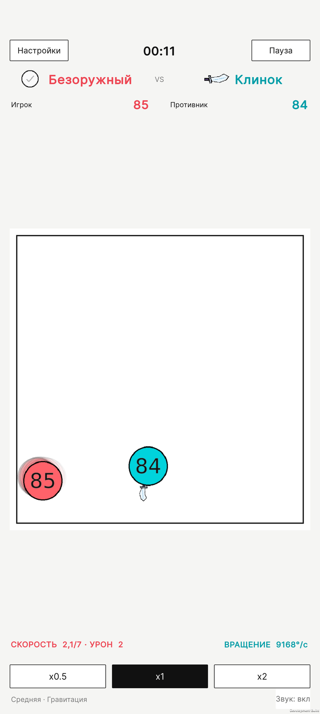

# ArmOrb

Симуляция боя двух вооружённых шаров для Android. Выбрать оружие, здоровье, размер арены и физику, затем запустить бой. Шары двигаются и атакуют автоматически.

**Unity 6000.4.0f1 · Android 8.0+ · ARM64 · портретная ориентация · v0.4.0**

**[Скачать APK v0.4.0](https://github.com/EnotikPoker/ArmOrb/raw/refs/heads/android-builds/ArmOrb-v0.4.0.apk)** · [Проверки](docs/VALIDATION.md) · [Изменения](CHANGELOG.md) · [Разбор референсов](docs/REFERENCE_PHYSICS.md)

 

## Запустить проект в Unity

1. Установить **Unity 6000.4.0f1** через Unity Hub. Для Android нужны Android Build Support, SDK/NDK и OpenJDK.
2. Скачать исходники:

   ```bash
   git clone --single-branch --branch feature/v0.4-reference-physics-shield-crossbow git@github.com:EnotikPoker/ArmOrb.git
   ```

3. В Unity Hub выбрать **Add → Add project from disk** и папку `ArmOrb`.
4. Открыть `Assets/ArmOrb/Scenes/Main.unity` и нажать **Play**. В Game выбрать вертикальное соотношение 9:16 или 9:20.

Сцена, префабы и настройки сохранены. Ручная сборка объектов не требуется.

## Настройки боя

| Настройка | Значения |
| --- | --- |
| Оружие | Меч, копьё, клинок, коса, щит, безоружный, лук, посох, сюрикен, арбалет — отдельно для каждой стороны |
| HP | 1–99999, по умолчанию 100 |
| Арена | Маленькая 6×6, средняя 8×8, большая 10×10 |
| Скорость | x0.5, x1, x2; доступна также во время боя |
| Гравитация | Падение по дугам и высокие отскоки; можно отключить |

При первом запуске выбраны средняя арена, x1 и включённая гравитация. Эти три настройки сохраняются между запусками. Радиус шаров и размеры оружия не зависят от карты: маленькая арена даёт более крупные изображения и частые встречи.

Множитель меняет время всей симуляции, включая движение, вращение, яд и таймер. Переключение не начинает новый бой. При x2 одна и та же последовательность событий занимает вдвое меньше реального времени, чем при x1. Множитель действует также на очередь лука, отражённые снаряды и визуальный след безоружного.

Пауза останавливает бой. При сворачивании приложение также ставит его на паузу. Продолжение — кнопкой «Продолжить». Android Back / Escape открывает паузу. После завершения доступны повтор и возврат в настройки.

## Оружие и попадания

| Оружие | Старт | Усиление |
| --- | --- | --- |
| Меч | Урон 1 | +1 к урону за попадание |
| Копьё | Урон 1, длина 3 радиуса | +0,5 радиуса к длине за попадание |
| Клинок | Урон 1, короткий клинок 1,8r, вращение 573°/с | +573°/с за попадание |
| Коса | Урон касания 1 | +1 к урону яда в секунду на цели за попадание |
| Щит | Собственный урон 0, возврат прямого урона 100%, ширина 2,1r | +0,25r к ширине за фактически нанесённый возвращённый урон |
| Безоружный | Предел скорости 3, урон от текущей скорости перед ударом, минимум 1 | +0,5 к пределу за попадание; скорость не поднимается мгновенно |
| Лук | Очередь, интервал 0,06 с, урон стрелы 1, перезарядка 1 с после очереди | +1 стрела к следующим очередям за попадание |
| Арбалет | Одновременный веер 60°, урон стрелы 1, перезарядка 1 с | +1 стрела к следующим залпам за попадание |
| Посох | Перезарядка 1,5 с, урон волны 1, радиус 1,1 | +0,275 к радиусу следующих волн за попадание |
| Сюрикен | Перезарядка 1 с, урон 1, один отскок | +1 отскок следующим броскам за попадание |

Начальное вращение: меч 372°/с, копьё 286°/с, клинок 573°/с, посох 172°/с; прочие вооружённые виды — 300°/с. Скорости откалиброваны по свободным участкам референсов, а не назначены одинаковыми всем видам. Удар использует текущие характеристики, затем применяется усиление. Усиления и яд сбрасываются в новом бою. Игровых потолков длины, урона и вращения нет.

- У атакующих контактных видов урон наносит **всё видимое оружие**, включая рукояти и древки. Прозрачные пиксели и пустота внутри серпа косы не участвуют в контакте.
- Для повторного удара требуется разрыв контакта.
- При контакте разворачивается оружие, которое своим вращением двигалось внутрь контакта; второе не разворачивается автоматически. Касание тела также может развернуть атакующее оружие. Удерживаемые лук, арбалет, посох и сюрикен тоже имеют физический контур для реакции вращения, но не наносят урон касанием. Стены и обычные столкновения тел сами по себе не меняют направление вращения. Моменты контактов сравниваются внутри физического подшага: реальный блок может перехватить удар, но общий флаг пересечения оружий больше не отменяет все попадания по телам.
- Щит возвращает ровно 100% прямого урона ближнего оружия и не наносит собственного урона касанием. Стрелы, огненные шары и сюрикены отражаются со сменой владельца, сохраняя свой урон и свойства. При попадании отражённого снаряда усиление получает щит, исходный стрелок его не получает. Промахи и перехват без урона ширину не увеличивают. Яд и уже существующие взрывные волны не отражаются. Два щита без снарядов не могут повредить друг друга — такой бой можно остановить через настройки.
- Яд складывается на цели, действует до конца боя и наносит урон раз в секунду времени симуляции.
- Стены отражают тела; оружие может выходить за границы. Длинное оружие визуально обрезается областью просмотра, проверки идут по полной длине.
- Побеждает оставшийся в живых шар. Одновременная гибель — ничья.

## Баланс, физика и хитбоксы в Unity

Лук, арбалет, посох и сюрикен стреляют по направлению своего вращения, без наведения. Первый выстрел — после начальной перезарядки. Лук выпускает стрелы по одной каждые 0,06 с из одного места на шаре, фиксируя направление и удерживая оружие на время очереди. Точка выпуска следует за движущимся шаром. Число стрел фиксируется в начале очереди; новые попадания усиливают следующую. Перезарядка начинается после последней стрелы. Арбалет сохраняет прежнюю механику лука: одновременный веер 60°. Скорости: стрела 14, огненный шар 8, сюрикен 11. Снаряды летят прямо, без гравитации, и не повреждают владельца. Обычное оружие и другие снаряды их не перехватывают.

Стрелы исчезают о стену или цель. Сюрикен исчезает при попадании и после исчерпания отскоков; угол считается одним отскоком. Попадания увеличивают запас только следующих бросков. Снаряды и волны сохраняют параметры, полученные при создании.

Огненный шар взрывается о стену или тело противника; щит отражает сам снаряд. Урон наносит расширяющееся кольцо, а не сам снаряд и не вся область сразу. Кольцо растёт со скоростью 6 единиц/с, повреждает противника один раз и проходит через щит. Успешный взрыв увеличивает радиус следующих выстрелов. Промахи и блоки не усиливают атакующего.

Безоружный бьёт всей окружностью тела; повтор требует разрыва контакта. Щит может блокировать касание безоружного с возвратом урона. Его урон равен целой части скорости перед контактом, минимум 1. Предел начинается с 3 и растёт на 0,5 за попадание; в режиме гравитации рост предела не добавляет энергию сам по себе. Текущая скорость меняется под гравитацией и при обмене импульсом; весь вектор ограничивается личным пределом. Одна единица Speed/Damage соответствует 1,6 единицы скорости Unity — масштаб подобран по перемещению в референсе, а не приравнен числу из HUD. В плоском режиме без гравитации используется движение с личной предельной скоростью. За шаром остаётся короткий след.

`Assets/ArmOrb/Settings` содержит настройки арены и десяти вариантов оружия. Выбрать asset и изменить значения в Inspector до запуска боя. Размеры арены автоматически применяются к рамке, камере и симуляции; вручную менять сцену не нужно.

Стартовые значения: радиус 0,55; начальная скорость 6,4; гравитация 16,7; упругость 1; без принудительной высоты прыжка и минимальной горизонтальной скорости; симуляция 120 Гц. В режиме гравитации скорость не приводится к постоянной величине после столкновения. Высота отскока зависит от скорости перед ударом. На свободной дуге горизонтальная скорость сохраняется, а при упругом столкновении тел происходит обмен нормальными составляющими скорости без добавления энергии. Специальный предел безоружного отдельно ограничивает его скорость.

`ArenaSimulation` рассчитывает бой, `OrbMotion` — движение и столкновения тел, `SimulationClock` — множитель времени. `ProjectileCombat` рассчитывает выстрелы, отражения от стен и взрывные волны. Отдельные пулы переиспользуют состояния и Unity-объекты снарядов. Отображение интерполируется между фиксированными шагами. Число геометрических подшагов зависит от реальных линейных скоростей и вращения обоих оружий.

Хитбоксы находятся в `Assets/ArmOrb/Resources/WeaponShapes`. Это объединение прямоугольников непрозрачных пикселей, извлечённых из PNG. `WeaponGeometry.GetParts` задаёт одинаковые трансформации для рендера и попаданий. У копья древко повторяет текстуру, а наконечник сохраняет размер при росте.

Для просмотра хитбоксов включить **Show Hitboxes** у объекта **ArmOrb Game** и **Gizmos** в Unity во время Play. Показываются контуры контактного оружия, круги снарядов и волн. У стрелы хитбокс — капсула вдоль древка; остальные снаряды используют окружности.

Исходный генератор пиксельной графики: `Tools/generate_art.py` (нужен Pillow). После изменения PNG обновить маски и префабы через **ArmOrb → Rebuild starter scene and assets**. Эта команда восстанавливает стартовые значения баланса и перезаписывает сцену и префабы. Спрайты импортируются с Point-фильтрацией и без компрессии. Шрифт DejaVu Sans поддерживает кириллицу; лицензия рядом со шрифтом.

## Собрать APK

В Unity: **ArmOrb → Build Android APK**. Результат: `Builds/Android/ArmOrb-v0.4.0.apk`.

Из терминала:

```bash
export UNITY_EDITOR="$HOME/Unity/Hub/Editor/6000.4.0f1/Editor/Unity"
bash Tools/unity.sh android
```

Приложение `com.enotikpoker.armorb`, версия 0.4.0, versionCode 4. IL2CPP ARM64, Development Build, отладочная подпись Android. При использовании прежнего ключа APK обновляет установленную предыдущую версию без удаления данных. Для Google Play потребуются собственный ключ и релизная конфигурация.

APK и SHA-256 опубликованы отдельно от исходников в ветке [`android-builds`](https://github.com/EnotikPoker/ArmOrb/tree/android-builds). Изменения v0.4 находятся в ветке `feature/v0.4-reference-physics-shield-crossbow` до слияния PR в `main`.

## Проверки

В Unity: **Window → General → Test Runner → EditMode → Run All**. Или:

```bash
bash Tools/unity.sh test
```

XML: `TestResults/editmode.xml`, лог: `Logs/tests.log`. Проверяются правила усиления, контакты тел, перезарядки и веер стрел, быстрые снаряды, блоки щитом, углы арены, взрывные волны, воспроизводимость и скорости времени. Сохранены проверки пиксельных хитбоксов старого оружия, всех прежних сочетаний и границ трёх арен. Новые сочетания проверяются на компьютере.

Для замера эталонных боёв на компьютере: **ArmOrb → Measure reference fight tempo**. Это три боя меча с копьём при 100 HP на средней арене с гравитацией; телефон не используется.

`Tools/device_smoke.py` оставлен как необязательный инструмент. По умолчанию он проверяет один запуск. Флаг `--all-pairs` запускает 55 отдельных боёв с перезапусками; для обычной проверки изменений он не нужен. В v0.4 проверки телефона проводятся одним сеансом, без этого флага.

## Ограничения

Один локальный режим, без сети, прогрессии, рекламы и покупок. Баланс предварительный: некоторые пары могут сражаться долго; щит–щит без внешних снарядов не имеет источника урона. Неограниченный рост при очень большом HP увеличивает нагрузку на геометрические подшаги и количество снарядов. Пулы не вводят скрытый потолок количества стрел или усилений. Повторяемость по seed предполагает одинаковую версию, настройки и последовательность фиксированных шагов.
