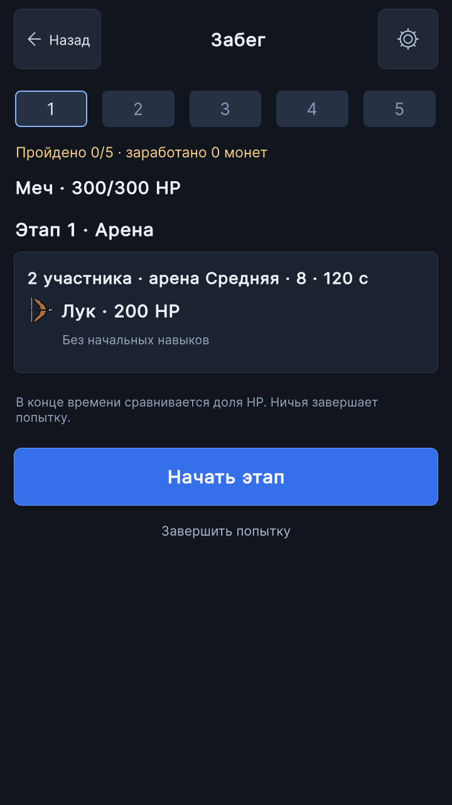
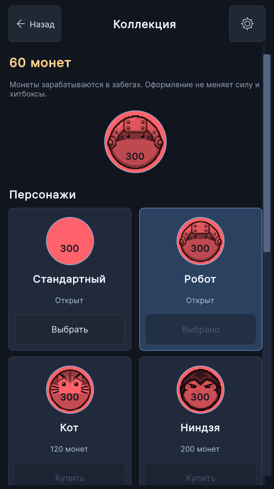

# ArmOrb

Бои вооружённых шаров для Android. Новый отдельный режим **«Забег»** связывает пять боёв с переносом HP и навыков. За этапы выдаются монеты для коллекции пиксельных персонажей и следов. **«С ботами»** сохраняет отдельные матчи с улучшениями и активкой, **«Ставки»** использует игровые жетоны, **«Тест»** позволяет вручную настроить бой.

**Unity 6000.4.0f1 · Android 8.0+ · ARM64 · портретная ориентация · v0.10.0**

**[Скачать APK v0.10.0](https://github.com/EnotikPoker/ArmOrb/raw/refs/heads/android-builds/ArmOrb-v0.10.0.apk)** · [Проверки](docs/VALIDATION.md) · [Изменения](CHANGELOG.md) · [Физика и баланс](docs/ACTIVE_COMBAT.md)

 

## Открыть в Unity

1. Установить **Unity 6000.4.0f1** через Unity Hub. Для Android нужны Android Build Support, SDK/NDK и OpenJDK.
2. Скачать исходники:

   ```bash
   git clone --single-branch --branch feature/v0.10-runs-and-collection git@github.com:EnotikPoker/ArmOrb.git
   ```

3. В Unity Hub выбрать **Add → Add project from disk**, указать `ArmOrb`.
4. Открыть `Assets/ArmOrb/Scenes/Main.unity`, нажать **Play**. Для Game выбрать вертикальное соотношение сторон.

Сцена, префабы, шрифт, спрайты и параметры сохранены; ручная сборка объектов не нужна.

## Забег и коллекция

**Пять этапов:** дуэль, бой на троих, элитная дуэль, бой на четверых и чемпион. Оружие и активка выбираются до старта. Начальное HP — 300. Между этапами сохраняются выбранные навыки и оставшееся здоровье; разгон оружия от попаданий сбрасывается. Возрождение и второе дыхание работают один раз за всю попытку.

После этапов 1–4 — выбор без таймера: лечение 40% максимального HP либо навык. Каждый бой ограничен **120 секундами**, без сужения; затем сравнивается доля оставшегося HP. Полное прохождение даёт **200 монет** и облик рыцаря. При поражении монеты пройденных этапов сохраняются.

Коллекция: стандартный шар, робот, кот, ниндзя, космонавт и рыцарь; базовый след, точки, искры и звёзды. Покупки за заработанные монеты, с подтверждением и постоянным открытием. Оформление не меняет силу и хитбоксы. Старый баланс ставок сохраняется отдельно как жетоны; обмена с монетами коллекции нет. Настоящих платежей и рекламы нет.

Забег сохраняется отдельно от обычного боя с ботами и ставки. Награды и покупки защищены от повторного начисления при загрузке. [Полные правила](docs/RUNS_AND_COLLECTION.md) · [Персонажи и промпты](docs/art/COSMETICS.md).

## Битва с ботами

Своё оружие, **1–4 ботов**, три сложности. У всех 300 HP, карты 8–14, гравитация и скорость ×1. Первый навык выбирается до старта, дальше — каждые **20 секунд**. Три карточки снизу, на выбор **8 секунд**, бой продолжается. Боты получают навыки на тех же этапах.

**30 улучшений:** максимальное HP, регенерация, барьеры, вампиризм, криты, возрождение, эффекты попаданий и по одной особой механике каждого оружия. Числовые усиления имеют до трёх уровней, особые механики берутся один раз. Внизу виден собранный билд и описания навыков.

Один основной вариант: улучшения и **активная способность** с перезарядкой 20 с. Лечение даёт 100 HP, барьер поглощает 120 урона на срок до 5 с. Характеристики своего оружия постоянно видны под ареной, нажатие на участника открывает его оружие и билд без паузы. Три навыка показываются строками с собственными значками и изменением чисел. Искры и вариант без активки доступны только при продолжении ранее сохранённого боя v0.8.

Свой шар выделен синей обводкой; внутри шаров только крупное HP. Та же обводка отмечает участника ставки. **Сужения в боях с ботами нет.** На пятой минуте победитель определяется по доле оставшегося HP. Сохранение восстанавливает карточки, эффекты и таймеры. Попытки v0.8 продолжаются с сохранением боя и навыков; к открытому выбору добавляется секунда. Попытки v0.6/v0.7 архивируются с уведомлением. Монеты и ставки сохраняются.

[Все навыки, сочетания и правила обычного боя](docs/BOT_BATTLE.md).

## Ставки

- Случайный бой: 2–5 участников, десять видов оружия с возможностью повторений, индивидуальное здоровье 50/100/150/200/250/300, размер арены и наличие гравитации. Цвет и номер обозначают участника во всех экранах.
- Все условия и коэффициенты показаны до ставки. Можно бесплатно сменить состав или посмотреть бой без ставки. Просмотр расходует предложение: поставить на уже просмотренный сид нельзя.
- Коэффициенты оцениваются скрытыми симуляциями того же состава и правил с другими начальными сидами. Минимум 16, максимум 64 завершённых прогона; ориентир ожидания — 10 секунд. Если минимум не достигнут, расчёт продолжается дольше. Отображается число прогонов, оценка не гарантирует исход.
- Сглаживание добавляет по 0,5 условной победы каждому участнику; одинаковые оружие и HP получают объединённую оценку. Коэффициент — обратная оценка вероятности победы среди исходов без ничьей, без комиссии, округлённая вниз до двух знаков.
- Начальный баланс 1000 жетонов. Ставка на одного победителя, от 10 жетонов с шагом 10. При победе возвращается полная показанная выплата `floor(ставка × коэффициент)`, при ничьей — сама ставка. Жетоны только игровые, без покупки и вывода.
- Если баланс ниже 10 и незавершённой ставки нет, доступно бесплатное восстановление до 1000.
- Выход в меню и закрытие приложения сохраняют ставку. После возвращения можно продолжить тот же бой; новая ставка доступна после его окончания. Приложение восстанавливает состояние воспроизведением сида до сохранённого тика и открывает бой на паузе.

## Тестовый режим

| Настройка | Значения |
| --- | --- |
| Участники | 2–5, оружие и здоровье каждому |
| HP | 1–99999, по умолчанию 100 |
| Арена | 6×6, 8×8, 10×10, 12×12, 14×14 |
| Скорость | x0.5 / x1 / x2, в том числе во время боя |
| Физика | Гравитация или движение без неё |
| Поддержка активности | Мягкое сближение после затишья, можно отключить |
| Опасность | Сужающийся безопасный круг с 90 с, можно отключить |

Размер, скорость и переключатели сохраняются между запусками. Множитель времени одинаково влияет на движение, вращение, перезарядку, яд, опасную зону и таймер; он не меняет исход при одинаковой последовательности тиков. Пауза останавливает симуляцию. Сворачивание и Android Back также ставят текущий бой на паузу.

## Оружие

| Оружие | Старт и усиление |
| --- | --- |
| Меч | Урон 1; +1 за попадание |
| Копьё | Урон 2, длина 3,5r; +0,5r за попадание |
| Кинжал (клинок) | Урон 2, длина 1,8r, вращение 573°/с; плавный разгон без потолка |
| Коса | Урон 1; +1/с яда на цели за удар, эффект складывается |
| Щит | Нет урона касанием, возврат 100% прямого урона; +0,25r ширины за успешную отражённую атаку |
| Безоружный | Стартовая скорость 6,4; урон от скорости до контакта, минимум 1; реальный разгон за попадания |
| Лук | Последовательная очередь, интервал 0,06 с; +1 стрела следующей очереди за попадание |
| Арбалет | Одновременный веер 60°; +1 стрела следующего залпа за попадание |
| Посох | Урон волны 3, начальный радиус 1,5; +0,35 радиуса за поражённого врага |
| Сюрикен | Один отскок; +1 отскок следующим броскам за попадание |

Перезарядка сюрикена — 0,8 с, остального дальнего оружия — 1 с. У лука она начинается после последней стрелы; лук продолжает вращаться, каждая стрела использует его текущее направление. Скорости снарядов: стрела 14, огненный шар 10, сюрикен 11. Собственные снаряды не опасны, гравитация на них не действует.

Щит меняет владельца снаряда и отражает его; тот может попасть в любого другого живого участника. Сам блок без последующего урона не увеличивает щит. Волны и яд не отражаются. Одна волна повреждает каждого врага не более одного раза. Снаряды и волны сохраняют параметры, полученные при создании.

У контактного оружия проверяется весь видимый непрозрачный контур; повторное попадание требует разрыва контакта. Оружие меняет вращение по направлению движения в точке контакта. Удерживаемое дальнее оружие участвует в контактах, но не бьёт рукоятью. Стены не меняют вращение.

Безоружный повреждает противника телом. Урон — `max(1, floor(скорость / 1,6))` до обмена импульсом. Уровень разгона начинается с 4, растёт на 0,5 за попадание до 12. Удар добавляет до 0,8 мировой единицы/с в пределах заработанного разгона; скорость от падения или столкновения не обрезается. За шаром остаётся короткий след.

Выбывшие участники больше не двигаются, не стреляют и не мешают столкновениям. Выпущенные снаряды, волны и наложенный яд сохраняются. Побеждает последний живой участник; одновременная гибель всех — ничья. Усиления сбрасываются в новом бою.

## Движение и опасная зона

Радиус тела 0,55, базовая скорость 6,4, гравитация 16,7, упругость 1, симуляция 120 Гц. Свободные дуги и упругие отскоки сохраняются. После 4 с без контакта конкретного шара либо 8 с без урона во всём бою плавно включается сближение с ближайшим живым противником. В гравитации корректируется горизонтальная скорость, без гравитации — направление. Контакт отключает коррекцию; выстрелы и стены не сбрасывают таймер.

В ставках обе меры активности включены. С 90 с безопасный круг за 30 с сужается до нуля. Снаружи урон возрастает от 5 до 20 HP/с; с 120 с вся арена наносит 20 HP/с. Стены остаются на месте. Опасность не отражается и не усиливает оружие, поэтому даже бой одних щитов завершается. Для стартового HP до 300 верхняя граница — около 135 с симуляции.

## Разработка и сборка

Параметры находятся в `Assets/ArmOrb/Settings`, пиксельные маски — в `Assets/ArmOrb/Resources/WeaponShapes`. `WeaponGeometry` задаёт общие трансформации изображения и хитбоксов. В Inspector включить **Show Hitboxes**, в Game/Scene — **Gizmos**.

После изменения PNG выполнить **ArmOrb → Rebuild starter scene and assets**. Команда перезаписывает стартовый баланс, сцену и префабы. Генератор исходной графики — `Tools/generate_art.py`, нужен Pillow. Спрайты используют Point-фильтрацию; лицензия DejaVu Sans находится рядом со шрифтом.

В Unity: **ArmOrb → Build Android APK**. Или:

```bash
export UNITY_EDITOR="$HOME/Unity/Hub/Editor/6000.4.0f1/Editor/Unity"
bash Tools/unity.sh android
```

Результат — `Builds/Android/ArmOrb-v0.10.0.apk`, пакет `com.enotikpoker.armorb`, versionCode 11. IL2CPP ARM64, Development Build с прежней отладочной подписью. APK обновляет предыдущую версию без удаления данных. APK и SHA-256 публикуются в отдельной ветке [`android-builds`](https://github.com/EnotikPoker/ArmOrb/tree/android-builds).

Данные монет и ставки: `Application.persistentDataPath/v05/wallet.json`, атомарная замена и резервная копия. Ставка и списание сохраняются вместе; расчёт выплаты защищён ID. Состояние боя сохраняется раз в две секунды, при паузе и сворачивании. После аварийного завершения возможен откат нескольких последних секунд того же боя. При несовместимости будущих правил ставка возвращается.

## Проверки

**Window → General → Test Runner → EditMode → Run All** или `bash Tools/unity.sh test`. XML — `TestResults/editmode.xml`, лог — `Logs/tests.log`.

Для воспроизводимого отчёта 110 парных и 16 случайных боёв:

```bash
"$UNITY_EDITOR" -batchmode -nographics -quit -projectPath "$PWD" \
  -executeMethod ArmOrb.Editor.SimulationReport.Run -logFile Logs/report.log
```

CSV — `Artifacts/v0.5-validation/simulations.csv`. Тяжёлые переборы выполняются на компьютере; телефон используется для короткой проверки интерфейса и восстановления ставки. Одинаковый сид воспроизводит бой в одной версии с одинаковыми параметрами и фиксированными тиками.
