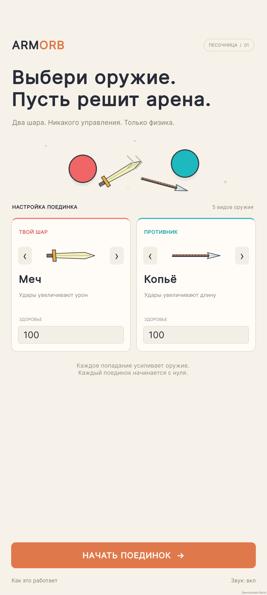

# ArmOrb

Тестовая 2D-арена для Android: два шарика автоматически отскакивают от стен и сражаются вращающимся оружием. Выбираешь оружие и здоровье обеих сторон, запускаешь бой и наблюдаешь, как растут характеристики.

**Unity 6000.4.0f1 · Android 8.0+ · ARM64 · портретная ориентация · v0.1.0**

**[Скачать APK v0.1.0](https://github.com/EnotikPoker/ArmOrb/raw/refs/heads/android-builds/ArmOrb-v0.1.0.apk)** · [Проверки первой версии](docs/VALIDATION.md)



## Открыть в Unity

1. Установить через Unity Hub **Unity 6000.4.0f1** с **Android Build Support**, SDK/NDK и OpenJDK.
2. Клонировать проект:

   ```bash
   git clone git@github.com:EnotikPoker/ArmOrb.git
   ```

3. В Unity Hub выбрать **Add → Add project from disk** и папку `ArmOrb`.
4. После импорта открыть `Assets/ArmOrb/Scenes/Main.unity` и нажать **Play**. Для окна Game выбрать вертикальное соотношение 9:16 или 9:20.

Сцена, шесть префабов и настройки уже сохранены в репозитории. Ручная сборка объектов не требуется. Меню **ArmOrb → Rebuild starter scene and assets** предназначено для восстановления стартовой конфигурации и **перезаписывает** её настройки баланса и префабы.

## Играть

Выбрать оружие стрелками в карточках, указать здоровье каждого шарика (1–99999) и нажать **Начать поединок**. Можно выбрать одинаковые оружия. Движение и атаки происходят автоматически; управления шариком нет.

В бою отображаются здоровье, усиливаемая характеристика, накопленный яд и время. Доступны пауза, отключение звука и возврат к настройкам. После завершения можно начать новый случайный бой с теми же настройками. При сворачивании приложения бой приостанавливается; продолжение — кнопкой на экране. Android Back / Escape вызывает паузу.

| Оружие | Начальные характеристики | Усиление |
| --- | --- | --- |
| Меч | Урон 1, вращение 180°/с | +1 к урону за попадание |
| Копьё | Урон 1, длина 3 радиуса | +0,5 радиуса длины за попадание |
| Клинок | Урон 1, вращение 180°/с | +30°/с за попадание |
| Коса | Урон касания 1 | +1 к урону яда в секунду на цели за попадание |
| Щит | Урон касания 1, возврат 100% | +25 процентных пунктов к возврату за блок |

- Удар использует текущий урон; усиление применяется после него. Непрерывное касание не наносит урон каждый кадр: нужен разрыв контакта.
- Столкновения оружий разворачивают вращение и отталкивают шарики. Обычные столкновения оружий не усиливают их.
- Щит отражает прямой урон только при столкновении с оружием. Яд и отражённый урон повторно не отражаются. Два щита могут наносить урон касанием тела.
- Яд складывается на цели и действует до конца боя. Тики раз в секунду по времени матча.
- Оружие может выходить за стены. Копьё растёт без игрового потолка. Характеристики остальных оружий также не ограничены.
- Побеждает оставшийся в живых шарик. Одновременная гибель — ничья. При новом бое здоровье, яд и усиления сбрасываются.

## Настроить баланс

В `Assets/ArmOrb/Settings` находятся ScriptableObject для арены и всех пяти оружий. Выбрать нужный asset и менять значения в Inspector до запуска боя.

`Arena.asset` задаёт размер арены, радиус и скорость шариков, частоту симуляции и цвета. Стартовая арена — 10×10, радиус — 0,55, скорость — 3,8, симуляция — 120 Гц. После изменения размера арены следует изменить рамку в сцене и Orthographic Size камеры под новый размер. Параметры оружия: урон, длина в радиусах шарика, скорость вращения, прирост и коэффициент отражения.

Симуляция отделена от GameObject: `ArenaSimulation` управляет матчем, `OrbMotion` — движением, `WeaponGeometry` — контактами, `HealthState` и `WeaponState` — состояниями боя. Отображение, звук и UI подписываются на события. Геометрические подшаги ограничивают перемещение кончика оружия между проверками и учитывают рост длины и скорости. Физика собственная 2D, без гравитации, с отражениями и раздвиганием пересечений тел.

Оружие и тела используют собственные рисованные геометрические спрайты. Исходный генератор: `Tools/generate_art.py` (опционально нужен Pillow). Шрифт DejaVu Sans содержит кириллицу; лицензия находится рядом с ним.

## Собрать APK

В редакторе: **ArmOrb → Build Android APK**. Результат:

```text
Builds/Android/ArmOrb-v0.1.0.apk
```

Из терминала:

```bash
export UNITY_EDITOR="$HOME/Unity/Hub/Editor/6000.4.0f1/Editor/Unity"
bash Tools/unity.sh android
```

Приложение: `com.enotikpoker.armorb`. Сборка IL2CPP ARM64, Development Build, с отладочной подписью Android. Для Google Play потребуется собственный ключ и отдельная релизная конфигурация. Ключи и APK не попадают в ветку исходников.

## Проверки

В Unity: **Window → General → Test Runner → EditMode → Run All**. Или:

```bash
bash Tools/unity.sh test
```

Результаты: `TestResults/editmode.xml`, лог: `Logs/tests.log`. Тесты проверяют усиления, яд, блоки, геометрию, повторные контакты, границы, одновременную гибель, повторяемость по seed, быстрый клинок и длинное копьё, а также все 15 сочетаний оружия на трёх seed.

Проверка на подключённом телефоне с включённой USB-отладкой:

```bash
adb devices
python3 Tools/device_smoke.py --serial DEVICE_SERIAL \
  --apk Builds/Android/ArmOrb-v0.1.0.apk
```

Если `adb` не в PATH, передать `--adb /путь/к/Android/SDK/platform-tools/adb`. По умолчанию скрипт проверяет один запуск: меч против копья. Для полного перебора есть отдельный флаг `--all-pairs`, который перезапускает приложение 15 раз; он не нужен для обычной проверки изменений. Логи и снимки экрана сохраняются в `TestResults/device`. QA intent работает только в Development Build. Фактические результаты первой версии описаны в [docs/VALIDATION.md](docs/VALIDATION.md).

## Границы первой версии

Один локальный тестовый режим, без сети, прогрессии, рекламы и покупок. Баланс стартовый; длительность боёв зависит от оружия и случайных траекторий. Рост характеристик не ограничен, поэтому очень долгие бои с огромным здоровьем могут увеличивать нагрузку на симуляцию. Отображение оружия обрезается краями области просмотра, но попадания вычисляются по полной длине.
